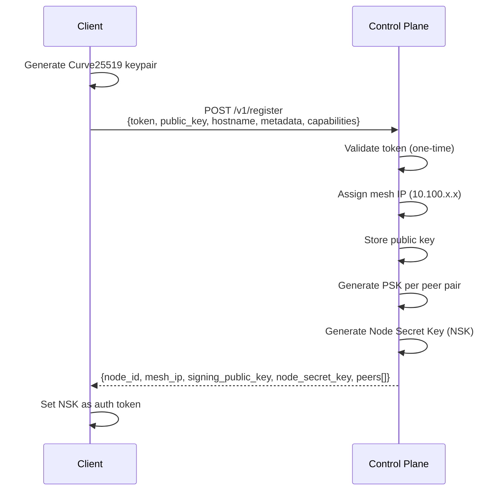
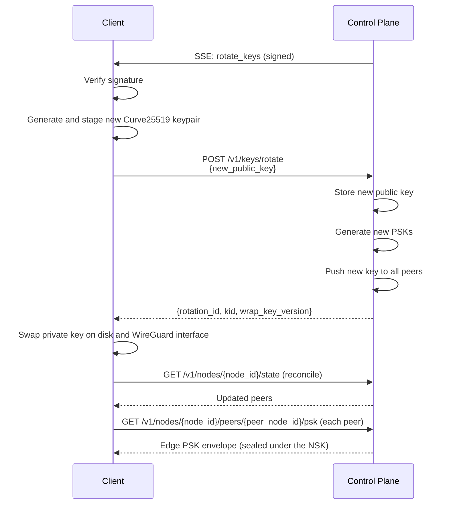
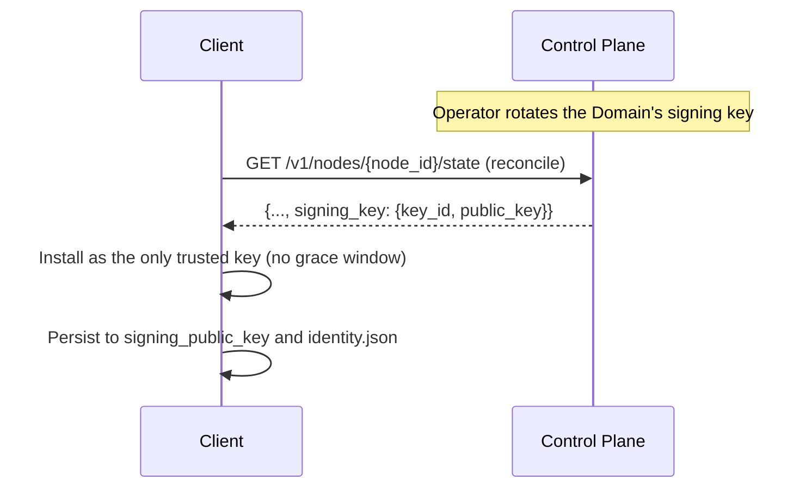

# Security & Trust Model

## Security Overview

- **Bootstrap tokens** are one-time-use with a short TTL. They are deleted from disk after successful registration.
- **Private keys** are generated during registration and stored in `/var/lib/plexd/` on Linux, and under the platform data directory on macOS and Windows (see [Platform defaults](../reference/core/configuration.md#platform-defaults)). They never leave the node.
- **Control plane communication** is TLS-encrypted (HTTPS). The agent validates the server certificate. Every SSE event is additionally signed with the control plane's Ed25519 key and verified by the agent before processing.
- **Mesh traffic** is encrypted end-to-end via WireGuard.
- **Compromised nodes** can be force-removed from the control plane, triggering key rotation across all affected peers.
- **Hook integrity** is enforced via SHA-256 checksums computed at discovery, monitored via inotify, and re-verified before every execution against the digest pinned at first discovery — there is no checksum on the wire, and the inotify watcher deliberately cannot move that pin. Mismatches block execution and trigger alerts.
- **Binary verification** - plexd reports its own SHA-256 checksum at registration and with every heartbeat. The control plane compares against known-good checksums per version.

## Key Exchange and Trust Model

plexd uses WireGuard's [Noise_IKpsk2](https://www.wireguard.com/protocol/) handshake with static Curve25519 key pairs. The control plane acts as a trusted key distribution center but never has access to private keys. All events from the control plane (peer changes, policy updates, action requests, key rotations) are signed with an Ed25519 signing key and verified by the agent before processing.

### Trust Chain

```
Bootstrap Token (one-time, short TTL)
        │
        ▼
   Control Plane  ──── Trust anchor: distributes public keys, PSKs,
        │               and its own Ed25519 signing public key
        │
        ├──► Signing Key ──── Verifies all SSE events + session JWTs
        │
        ▼
   Node Identity  ──── Public key bound to node ID and mesh IP
        │
        ▼
   Peer Tunnels   ──── WireGuard E2E encryption (private key stays local)
```

### Phase 1: Registration

During registration the node generates its Curve25519 key pair locally. Only the public key is sent to the control plane. The private key never leaves the node.



### Phase 2: Tunnel Setup

The client configures the local WireGuard interface from the registration response and takes its peers from the reconciliation state pull:

1. Create WireGuard interface (`plexd0`)
2. Assign mesh IP and set private key
3. Fetch each peer's edge PSK (see [Pre-Shared Keys](#pre-shared-keys-psk)), then add each peer with its public key, endpoint, allowed IPs, and PSK (the endpoint is the first entry of the peer's dial order: its endpoint candidates on a shared subnet, its usable direct endpoint, its other candidates, then its relay fallback; plexd moves along the order until a handshake completes)
4. Run STUN discovery and report the node's public endpoint to the control plane
5. Receive the peers' NAT-discovered endpoints on later state pulls (a `peer_endpoint_changed` event brings the next pull forward) and update WireGuard accordingly

### Phase 3: Steady State

The control plane pushes peer and key updates via SSE. Every SSE event is signed with the Ed25519 signing key of the node's Domain. The client verifies the signature before applying any change.

**Signed Event Envelope:**

Every SSE event is wrapped in a signed envelope:

```json
{
  "id": "0190a8b8-a0c0-7a0a-8a0a-a0a0a0a0a0a0",
  "type": "node_state_updated",
  "scope": "domain:0190a8b8-a0c0-7a0a-8a0a-a0a0a0a0a0a1",
  "key_id": "signing-domain-0190a8b8-a0c0-7a0a-8a0a-a0a0a0a0a0a1-1767225600000000000",
  "issued_at": "2026-01-15T10:30:00Z",
  "payload": { "revision": 42 },
  "signature": "base64-encoded-ed25519-signature"
}
```

The `signature` is an Ed25519 signature over the SHA-512 digest of the envelope's canonical bytes, not over the bytes themselves. The "Signed event envelope" section of plexsphere's agent contract (`docs/reference/api/plexd-agent-contract.md` in plexsphere/plexsphere) defines the canonical bytes: one JSON object with the members `id`, `issued_at`, `key_id`, `payload`, `scope` and `type` in that order, no whitespace, and never `signature`. `issued_at` is UTC with exactly nine fractional digits. `scope` becomes an object: `domain:<uuid>` turns into `{"id":"<uuid>","kind":"domain"}`, `platform` turns into `{"id":"00000000-0000-0000-0000-000000000000","kind":"platform"}`, and any other scope cannot be verified. The payload is decoded and written again, with object keys sorted at every depth and numbers normalised (`1.50` becomes `1.5`). plexd rebuilds these bytes from the decoded fields, so the wire JSON's member order, time format, payload key order and number spelling do not matter. For the envelope above they are:

```text
{"id":"0190a8b8-a0c0-7a0a-8a0a-a0a0a0a0a0a0","issued_at":"2026-01-15T10:30:00.000000000Z","key_id":"signing-domain-0190a8b8-a0c0-7a0a-8a0a-a0a0a0a0a0a1-1767225600000000000","payload":{"revision":42},"scope":{"id":"0190a8b8-a0c0-7a0a-8a0a-a0a0a0a0a0a1","kind":"domain"},"type":"node_state_updated"}
```

See [Event Verification](../reference/core/event-verification.md) for the full rules and the error each failed check returns.

**Verification on every event:**

1. Check `issued_at` staleness (max 5 minutes) and reject timestamps more than 5 minutes in the future.
2. Select the signing key by the envelope's `key_id`: the Domain signing key the node holds, which registration handed it and a later state pull or `signing_key_rotated` event may have replaced, or the previous key while a `signing_key_rotated` grace window is open. Any other `key_id` is rejected.
3. Rebuild the canonical bytes, hash them with SHA-512, and verify the Ed25519 signature over that digest with the selected key.
4. If any check fails, reject the event and log it; the event is skipped and never dispatched.

This ensures that even if the TLS connection is compromised (e.g. through a rogue proxy or certificate authority), events cannot be forged without the private half of the key the node trusts. That key comes from registration and the state pull, which TLS alone protects (see below). Duplicate or reordered deliveries are harmless because the reconciler's authoritative state pull, not the event payload, is the source of truth. A replayed `session_revoked`, whose payload does close a session, can only name a session the control plane already revoked, which never becomes live again, so it finds nothing to close and only triggers a pull.

Action dispatch is one case where that distinction cuts both ways. A dispatch is read only from the `executions` block of the NSK-authenticated state pull, so no event payload — forged, replayed, or reordered — can make a node run an action. But the state response itself carries **no** application-layer signature: unlike an SSE envelope, it is protected by TLS alone. An attacker able to present a certificate the node's system trust store accepts — a misissued certificate, a rogue CA, or a deployment that set `tls_insecure_skip_verify` — can therefore inject an `executions` entry naming any registered action. Signing the executions block is a control-plane contract change and is not yet available; until it is, treat the TLS trust path (and never enabling `tls_insecure_skip_verify` outside a lab) as the boundary that protects remote execution.

The same holds for the Domain signing key, which the state response carries in its `signing_key` block. An attacker in that position can hand the node a key of its own, which plexd installs as the only key it trusts and persists, and can then sign envelopes and session tokens the node accepts. On Linux, a socket-activated session helper that has already pinned a key keeps refusing tokens signed with any other key (see [Trust anchor](../reference/networking/secure-access-tunneling.md#trust-anchor)).

The state response's `secrets` block, the node's secret inventory, is likewise protected by TLS alone, with no application-layer signature. A forged entry only lists a name, because the control plane authorizes every value fetch.

**SSE Events:**

| SSE Event | Client Action |
|---|---|
| `node_state_updated` | Trigger a state reconcile: refresh the local node state cache (metadata, data entries) and notify Node API consumers |
| `policy_updated` | Trigger a reconcile and update local firewall rules |
| `bridge_config_updated` | Trigger a bridge reconcile (bridge mode) |
| `peer_endpoint_changed` / `peer_key_rotated` | Trigger a state reconcile — peer topology is applied from the authoritative state pull, not the event payload |
| `action_request` | Trigger a state reconcile — the payload is opaque; action dispatches are delivered in the `executions` block of the authoritative state pull, never by the event (see [Remote Actions and Hooks](../reference/actions/remote-actions-hooks.md)) |
| `session_setup` | Trigger a state reconcile — the payload is opaque; the session is provisioned from the `sessions` block of the authoritative state pull, never from the event (see [Secure Access Tunneling](../reference/networking/secure-access-tunneling.md)) |
| `session_revoked` | Close the live session the payload names, then trigger a state reconcile. The payload (`session_id`, `jti`, `revoked_at`, `revoke_reason`) is parsed once the envelope is verified; one that does not decode, or whose `session_id` is empty or differs from its `jti`, closes nothing and only triggers the reconcile. The session's `session_ended` row reports `operator_revoke` for an operator-driven `revoke_reason`, or `ttl_expired` / `idle_timeout` for the control plane's sweeper. A later pull that still lists the session does not provision it again, and the session leaving the `sessions` block stays the teardown when the event is missed (see [Secure Access Tunneling](../reference/networking/secure-access-tunneling.md)) |
| `node_secrets_updated` | Trigger a state reconcile; the payload is opaque, and the secret inventory is read from the `secrets` block of the authoritative state pull, which feeds the Local Node API secret index (see [List available secret keys](../how-to/local-node-api.md#list-available-secret-keys)) |
| `rotate_keys` | Generate new Curve25519 keypair and initiate key rotation (see [Phase 4: Key Rotation](#phase-4-key-rotation)) |
| `signing_key_rotated` | Update the signing public key, selected by `key_id`. The control plane does not send this event today; a rotation reaches the node through the state pull (see [Signing Key Rotation](#signing-key-rotation)) |

### Phase 4: Key Rotation

Key rotation is triggered by the control plane - either on a schedule, by admin action, or in response to a compromised node. The `rotate_keys` signal arrives as a heartbeat flag or as a signed SSE event; the SSE event is verified before processing. The node stages a fresh keypair before submitting its public key, and the control plane replies with a rotation receipt (`rotation_id`, `kid`, `wrap_key_version`) rather than a peer list. The node swaps its private key only after that receipt, then picks up the new peers on the next state pull and fetches every edge PSK again (see [Pre-Shared Keys](#pre-shared-keys-psk)). A repeated signal within five minutes of the last committed rotation is skipped, so a `rotate_keys` flag the control plane keeps set until it observes the new key cannot rekey the node on every heartbeat; a rotation whose key is already staged is always resubmitted.



When a node is force-removed from the control plane, all peers that had a tunnel to the compromised node receive a `peer_deregistered` event followed by fresh PSKs for their remaining peer pairs.

### Signing Key Rotation

The Domain's Ed25519 signing key (used for SSE event signatures and session JWTs) can be rotated independently of WireGuard mesh keys. Every state pull carries the Domain's current key in its `signing_key` block, so once an operator rotates the key, the node picks up the incoming key on its next pull, within one reconcile interval.



plexd installs a pulled key that differs from the one it holds as the only key it trusts, and drops the old key at once: a pull install keeps no grace window. Until that pull the node refuses envelopes signed with the new key, and after it those signed with the old key. The pull carries every change those envelopes announced, so the node still converges. plexd writes the new key to the `signing_public_key` file and to `identity.json`, so a restart starts from it, and retries a failed write on every pull. plexd logs a new key as `installed signing key from state pull` with its `key_id` and `public_key`.

A `signing_key` of `null` means the control plane could not name the key this time (the Domain has no key yet, or the Signing Service was unreachable): plexd keeps the key it holds and never drops it. A key plexd cannot install (an empty `key_id`, or a public key that is not 32 bytes in standard base64) changes nothing, and plexd logs it as `signing key from state pull rejected` once, and not again until a pull carries a different key.

On Linux, a socket-activated session helper keeps the key it pinned, or the one `tunnel.session_signing_public_key` sets, and does not follow the pulled key. After a rotation, and on nodes enrolled before [plexsphere/plexsphere#918](https://github.com/plexsphere/plexsphere/pull/918) whose pin holds a key no signer uses, ssh logins fail at the helper until you set `tunnel.session_signing_public_key` to the `public_key` of the `installed signing key from state pull` line. A helper that uses the pin also recovers when you delete `/etc/plexd/session-signing-key`: its next run pins the key plexd persisted, so delete it only once plexd no longer logs `signing key not persisted; retrying on the next pull` (see [Trust anchor](../reference/networking/secure-access-tunneling.md#trust-anchor)).

plexd also handles a `signing_key_rotated` SSE event, which the control plane does not send today. Its payload names the new key (`key_id`, `public_key`) and may name the key it replaces (`previous_key_id`) with a deadline (`transition_expires`). When plexd holds that previous key, it keeps accepting it until the deadline. The event is signed with the **current** (old) key, which the node already trusts, so each key vouches for its successor. A later pull that carries a different key replaces both and ends the grace window.

### Pre-Shared Keys (PSK)

Each peer pair (an edge) uses its own PSK. The control plane derives it from the per-node PSKs of both nodes and serves it to each end separately, sealed under that node's NSK. PSKs provide:

- **Post-quantum resistance:** An additional symmetric key layer on top of the Curve25519 ECDH, protecting against future quantum attacks on elliptic-curve cryptography.
- **Defense in depth:** Even if the Curve25519 key exchange is compromised, the PSK layer prevents decryption.

plexd fetches each edge's PSK from `GET /v1/nodes/{node_id}/peers/{peer_node_id}/psk`. The answer is a 60-byte envelope (a 12-byte nonce, the encrypted 32-byte PSK and a 16-byte GCM tag), which plexd opens with AES-256-GCM under its NSK. The additional authenticated data binds the envelope to one edge and one epoch:

```text
plexsphere/mesh/edge-psk/v1|<this node's id>|<peer node id>|<epoch>
```

plexd lowercases both node IDs and takes the epoch verbatim from the `X-Plexsphere-PSK-Epoch` response header. An envelope sealed for another edge or another epoch does not open, and neither does a secret envelope, which carries no additional authenticated data. An envelope that fails to open installs nothing.

plexd fetches an edge's PSK when the peer first appears, when the peer's public key changes, and after this node completes its own key rotation, which reissues this node's half of every edge key. Other pulls fetch nothing, apart from retrying a fetch that failed. plexd keeps the highest epoch it accepted for each edge and refuses an envelope whose epoch sorts below it, so a replayed older envelope cannot bring back a retired key. The PSKs and their epochs live in memory only, so a restarted node fetches every PSK again. When a peer leaves the state pull, plexd drops its PSK. Keys, envelopes and the NSK never appear in a log line or an error.

WireGuard needs the same PSK on both ends of a tunnel, and a [NAT relay](../reference/bridge/nat-relay.md) forwards the WireGuard packets between the two peers unchanged. An edge between a plexd that installs edge PSKs and an older plexd therefore fails, direct and relayed alike, until both ends match. During a rolling upgrade, set `wireguard.edge_psk: false` on upgraded nodes (plexd then logs `edge psk disabled by wireguard.edge_psk` at start and fetches no PSK), and turn it back on once every node of the Domain runs a plexd that installs edge PSKs. See [Configuration](../reference/core/configuration.md#wireguard).

## Threat Model

| Scenario | Impact | Mitigation |
|---|---|---|
| Control plane compromised | Attacker has signing key - can forge SSE events and inject malicious peers | PSK layer for mesh traffic; signing key rotation to limit exposure window; admin-side integrity monitoring; nodes log all applied events for forensic analysis |
| Node compromised | Attacker has private key and NSK of one node | Force-remove node, trigger key rotation + PSK refresh on all affected peers; rotate NSK to prevent decryption of future secrets; secrets are not cached so no plaintext on disk to exfiltrate |
| Bootstrap token stolen | Attacker could register a rogue node | One-time-use + short TTL limits the attack window |
| MITM during registration | Could intercept public key exchange and signing key | TLS + server certificate validation on all control plane communication |
| MITM on SSE stream | Could inject forged events (peer changes, action requests, key rotations) | Ed25519 signature verification on every event; TLS as first layer; forged events rejected without valid signature |
| Signing key compromised | Attacker can forge SSE events until key is rotated | Operator rotates the Domain's signing key; every node installs the incoming key from its next state pull, within one reconcile interval, and refuses envelopes signed with the old key at once (a pull install keeps no grace window) |
| Session token stolen | Attacker could execute scoped actions on target node | Short TTL, node-bound, scoped action list, revocation on session end |
| Unauthorized local action execution | SSH user runs actions without permission | Requires valid session JWT; `--local` restricted to root and logged as emergency |
| Unauthorized secret access (local) | Attacker on node reads secrets via socket or K8s Secret | Linux/macOS: socket requires root or `plexd-secrets`; Windows: pipe requires an elevated Administrator or LocalSystem token; K8s Secrets contain only NSK-encrypted ciphertext; decryption requires plexd API with valid bearer token + live control plane |
| NSK compromised | Attacker could decrypt secret ciphertext from K8s Secrets or intercepted responses | NSK rotation invalidates old key; secrets are fetched in real-time so no historical ciphertext accumulates on-node; control plane re-encrypts with new NSK |
| plexd compromised (Linux) | Attacker controls the process that serves mediated ssh sessions | plexd starts no shell itself: the root session helper verifies every session token again against a signing key in `/etc/plexd`, which plexd's unit keeps read-only, so without a token the control plane signed the attacker cannot open a shell. Hosts without `plexd-session-helper.socket` run the helper as plexd's own child, which is no boundary |
| plexd compromised (macOS) | Attacker controls the process that serves mediated ssh sessions | No boundary: plexd runs as root under launchd and the session helper is its own child with the same privileges, so the helper's token check is a consistency check. A compromised plexd can start shells as any local account |
| Session token replayed after revocation | A compromised plexd reuses a token a client presented to open further shells | The listener closes when a verified `session_revoked` event names the session or the entry drains from the sessions block, but the helper cannot see revocations: the token stays usable until its `exp`. Tokens are short-lived and bound to one session id and user |

## Network Requirements

plexd requires the following network connectivity. All control plane communication is outbound-initiated from the node.

### Node Mode

| Direction | Protocol | Port | Destination | Purpose |
|---|---|---|---|---|
| Outbound | TCP/443 | - | Control plane API | Registration, heartbeat, observability, log/audit forwarding, callbacks |
| Outbound | TCP/443 | - | Control plane SSE | Real-time event stream (persistent connection) |
| Outbound | UDP/3478, UDP/19302 | - | STUN servers | NAT type discovery, public endpoint detection |
| Inbound/Outbound | UDP/51820 | 51820 | Mesh peers | WireGuard encrypted mesh traffic (P2P) |

### Bridge Mode (additional)

| Direction | Protocol | Port | Destination | Purpose |
|---|---|---|---|---|
| Inbound | UDP | pulled `listen_port` | NAT relay clients | WireGuard relay for nodes behind symmetric NAT, when `bridge.relay_enabled` is true and the control plane enables the relay. The control plane sets the port per bridge, in the state pull's `bridge.relay.listen_port`. See [NAT Relay](../reference/bridge/nat-relay.md) |
| Inbound | TCP/443 | 443 | Public internet | Public ingress (if `ingress.enabled`) |
| Inbound | UDP/51821 | 51821 | User access clients | WireGuard user access (if configured) |
| Outbound | UDP/varies | - | Site-to-site peers | VPN tunnels to external networks |

> **Note:** Nodes behind NAT do not need any inbound port forwarding. STUN discovery and relay fallback handle NAT traversal automatically.
