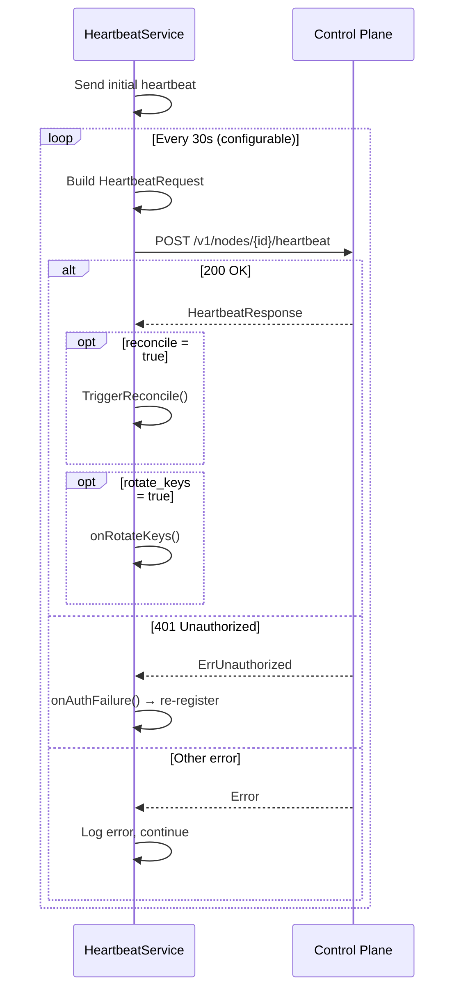

# Heartbeat Service

The `internal/agent` package implements the `HeartbeatService`, which sends periodic heartbeat requests to the control plane and processes directive flags from the response. The same package holds the [`HandshakeReporter`](#handshake-reporter), which reports the WireGuard handshake with each mesh peer at the heartbeat interval.

## Config

| Field      | Type            | Default | Description                    |
|------------|-----------------|---------|--------------------------------|
| `Interval` | `time.Duration` | `30s`   | Heartbeat send interval        |
| `NodeID`   | `string`        | —       | Node identifier (required)     |

## Heartbeat Loop

`HeartbeatService.Run(ctx)` operates as follows:



1. Send one heartbeat immediately on start
2. Start a ticker at the configured interval (default 30s)
3. On each tick, build and send a `HeartbeatRequest`
4. Process the `HeartbeatResponse` directive flags
5. Continue until context is cancelled

`Run()` always returns nil.

## Request Payload

The heartbeat request is built by an optional `buildRequest` function. If not set, a zero-valued `HeartbeatRequest` is sent. The builder typically collects runtime state:

```go
type HeartbeatRequest struct {
    ClientNow      time.Time      `json:"client_now"`
    BinaryChecksum string         `json:"binary_checksum"`
    BinaryVersion  string         `json:"binary_version"`
    NATSummary     map[string]any `json:"nat_summary"`
}
```

`NATSummary` is always a non-nil map so it marshals as a JSON object: `{}`
before NAT discovery has a result, otherwise `{"endpoint", "nat_type"}`. A
`null` value is rejected by the control plane.

## Response Handling

The control plane returns a `HeartbeatResponse` with directive flags:

```go
type HeartbeatResponse struct {
    AcceptedAt time.Time `json:"accepted_at"`
    Reconcile  bool      `json:"reconcile"`
    RotateKeys bool      `json:"rotate_keys"`
}
```

On acceptance, `accepted_at` is logged at **debug** level alongside the local
send time so operators can estimate the clock skew between the node and the
control plane.

| Flag          | Action                                              |
|---------------|-----------------------------------------------------|
| `reconcile`   | Call `ReconcileTrigger.TriggerReconcile()`           |
| `rotate_keys` | Call the `onRotateKeys` callback                    |

## Error Handling

### 401 Unauthorized

When the heartbeat receives a 401 error (`api.ErrUnauthorized`), the `onAuthFailure` callback is invoked. In production (`plexd up`), this triggers re-registration:

1. Call `registrar.Register(ctx)` to obtain a new identity
2. Update the control plane client auth token via `client.SetAuthToken()`
3. Log the re-registration result

If re-registration fails, the error is logged and the heartbeat continues retrying on the next tick.

### Clock Skew

When the heartbeat is rejected with the `clock_skew` problem code — the control plane found `client_now` more than 60s from its own time — the service logs at **error** level, instructing the operator to synchronize the system clock via NTP. There is no extra retry; the next attempt is the next 30s tick.

### Other Errors

Non-401 errors are logged at error level. The heartbeat loop continues on the next tick interval.

## Callbacks

| Method                | Signature      | Description                                |
|-----------------------|----------------|--------------------------------------------|
| `SetReconcileTrigger` | `ReconcileTrigger` | Reconciler to trigger on `reconcile=true` |
| `SetOnAuthFailure`    | `func()`       | Called on 401 Unauthorized                 |
| `SetOnRotateKeys`     | `func()`       | Called on `rotate_keys=true`               |
| `SetBuildRequest`     | `func() HeartbeatRequest` | Custom request builder          |

## Handshake Reporter

`HandshakeReporter` (`internal/agent/handshakes.go`) reports, for every mesh peer, the age of the latest completed WireGuard handshake and the endpoint WireGuard used for it to `POST /v1/nodes/{node_id}/handshakes`. The control plane derives each mesh edge's status, mode, handshake age and endpoint from these reports. See [Control Plane API Endpoints](api-endpoints.md#mesh-edge-health) for the wire format and status codes.

```go
func NewHandshakeReporter(interval time.Duration, nodeID string, client HandshakeReportClient, source MeshPeerStatsSource, logger *slog.Logger) *HandshakeReporter

func (r *HandshakeReporter) Run(ctx context.Context) error
```

A non-positive `interval` becomes `DefaultHeartbeatInterval` (30s). Every log line carries `component=handshake-report`. `Run` returns nil once its context is done.

### Cadence

The reporter is a loop of its own that ticks at `heartbeat.interval`. It does not ride on the heartbeat request, because a slow report would then delay the liveness signal. It sends nothing when `Run` starts, since no handshake can exist yet, and then reports on every tick. A tick with no handshake sends `"peers": []`: the contract asks for one report per heartbeat interval, and an empty report is valid and records nothing.

`plexd up` starts the reporter only when the WireGuard interface came up. Otherwise it logs `wireguard unavailable, skipping peer reconcile handler, handshake reports, tunnel metrics, endpoint selection and endpoint candidates` and sends no report. The report has no configuration key of its own: it follows `heartbeat.interval`.

A failed report is never retried within its tick. The next tick reads the device again and builds a fresh body with a fresh `observed_at` and fresh ages, because the control plane anchors each age on its own receive time and a replayed age would make the handshake look newer than it was. There is no final report on shutdown either.

Each tick runs these steps in order:

1. Read `MeshPeerStats()` from the source. A read error logs a Warn and sends nothing this tick.
2. Take `observed_at` from the clock, in UTC. It is taken after the read, so no age comes out negative on a steady clock.
3. Build the body with `buildHandshakeReport`.
4. Send it with `ReportHandshakes`.
5. Classify the answer: a cancelled context returns silently, a not-served answer logs only on the transition into that state (see [Not-served behavior](#not-served-behavior)), and every other answer logs one of the lines below.

### Build rules

`buildHandshakeReport(observedAt time.Time, stats []wireguard.MeshPeerStat) (req api.HandshakeReportRequest, skipped, truncated int)` turns the device read into the request body. `req.Peers` is never nil. One bad entry gets the whole report refused with a `400`, so the builder applies the contract's rules before anything is sent:

| Peer | Result |
|------|--------|
| `LastHandshake` is zero | Left out without a count: the contract omits a peer with no handshake |
| `NodeID` is not a UUID, or is `00000000-0000-0000-0000-000000000000` | Left out and counted in `skipped`: one such ID gets the whole report refused with `400 malformed_handshake_report` |
| Endpoint is invalid, has port 0, or an unspecified address | Left out and counted in `skipped` |
| Endpoint is an IPv4-mapped IPv6 address (`[::ffff:198.51.100.7]:51820`) | Unmapped to `198.51.100.7:51820`; otherwise the control plane's `mode: relayed` comparison against the plain-IPv4 fallback endpoint never matches |
| Endpoint carries an IPv6 zone (`[fe80::1%eth0]:51820`) | Zone stripped to `[fe80::1]:51820`. The control plane refuses a zoned endpoint with `400 handshake_endpoint_unparseable` for the whole report, and leaving the peer out instead would make a working link-local edge read `never_reported` |
| `NodeID` appears twice | The entry with the smaller age is kept |

The endpoint is rendered with `netip.AddrPort.String()`, which puts an IPv6 host in brackets. The age is `observedAt` minus `LastHandshake`, floored to whole seconds, so 4.9s reports as 4. A negative age, from a wall clock stepped back, reports as 0, and an age above `math.MaxInt32` reports as 2147483647.

Entries are sorted by age ascending, then by `peer_node_id`. Beyond `api.MaxHandshakeReportPeers` (4096) the oldest entries are cut and counted in `truncated`, so the report keeps the most recent handshakes.

### Not-served behavior

A control plane that predates the operation answers `404`, and one that has not wired its handshake recording service answers `501 handshakes_not_provisioned`. `api.IsHandshakeReportNotServed` is true for both. The reporter logs the not-served line once, on the transition into that state, and keeps trying every tick. When a report is accepted again it logs the recovery line once and clears the state. This is the pattern `PlatformReporter` uses for `501 observability_ingest_not_provisioned`. Every other failure, a `501` with another code included, logs at Warn or Error on every tick it occurs.

### Logging

| Level | Message | When |
|-------|---------|------|
| Info  | `agent: handshake report: started` | `Run` starts; carries `interval` |
| Warn  | `agent: handshake report: read peer stats failed` | The device read failed; carries `error`. Nothing is sent that tick |
| Debug | `agent: handshake report: skipped peers` | `skipped > 0`; carries `count` |
| Warn  | `agent: handshake report: more peers than the contract allows, reporting the most recent` | `truncated > 0`; carries `peers` and `max` |
| Info  | `agent: handshake report: control plane does not accept handshake reports, retrying every interval` | The first not-served answer; carries `status` and `code` |
| Error | `agent: handshake report: rejected for clock skew, synchronize the system clock via NTP` | `400 handshake_clock_skew`: `observed_at` is more than 60s from the control plane's time |
| Warn  | `agent: handshake report: send failed` | Any other failure; carries `error` |
| Info  | `agent: handshake report: control plane accepts handshake reports` | The first accepted report after a not-served answer |
| Debug | `agent: handshake report: accepted` | Every accepted report; carries `sent`, `recorded`, `ignored` and `accepted_at` |

## Integration Wiring

In `plexd up`, the heartbeat service is wired as follows:

```
HeartbeatService
├── client: ControlPlane (sends heartbeat RPCs)
├── reconcileTrigger: Reconciler (triggers state reconciliation)
├── onAuthFailure: re-registers → updates auth token
└── onRotateKeys: triggers reconcile (key material itself arrives via the signing_key_rotated SSE event)
```

The handshake reporter starts after the heartbeat goroutine (step `17a`), only when the WireGuard interface came up:

```
HandshakeReporter
├── interval: heartbeat.interval (the heartbeat config with defaults applied)
├── nodeID: registration identity
├── client: ControlPlane (sends ReportHandshakes RPCs)
└── source: wireguard.Manager (MeshPeerStats reads the device)
```

## Interfaces

```go
type HeartbeatClient interface {
    Heartbeat(ctx context.Context, nodeID string, req HeartbeatRequest) (*HeartbeatResponse, error)
}

type ReconcileTrigger interface {
    TriggerReconcile()
}

type HandshakeReportClient interface {
    ReportHandshakes(ctx context.Context, nodeID string, req api.HandshakeReportRequest) (*api.HandshakeReportResponse, error)
}

type MeshPeerStatsSource interface {
    MeshPeerStats() ([]wireguard.MeshPeerStat, error)
}
```

All four interfaces are small and testable. The `HeartbeatClient` and `HandshakeReportClient` are satisfied by `*api.ControlPlane`, `ReconcileTrigger` by `*reconcile.Reconciler`, and `MeshPeerStatsSource` by `*wireguard.Manager`.
