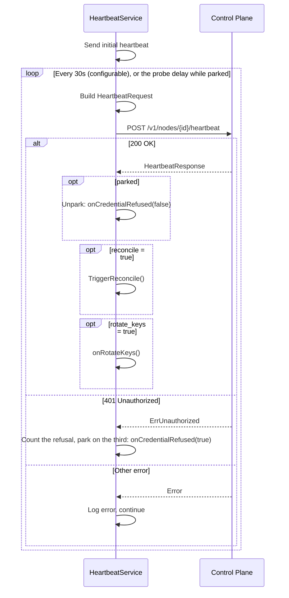

# Heartbeat Service

The `internal/agent` package implements the `HeartbeatService`, which sends periodic heartbeat requests to the control plane and processes directive flags from the response. The same package holds the [`HandshakeReporter`](#handshake-reporter), which reports the WireGuard handshake with each mesh peer at the heartbeat interval.

## Config

| Field      | Type            | Default | Description                    |
|------------|-----------------|---------|--------------------------------|
| `Interval` | `time.Duration` | `30s`   | Heartbeat send interval        |
| `NodeID`   | `string`        | —       | Node identifier (required)     |

## Heartbeat Loop

`HeartbeatService.Run(ctx)` operates as follows:



1. Send one heartbeat immediately on start
2. After every send, wait for the configured interval (default 30s), or for the probe delay while the service is parked (see [Credential Park](#credential-park))
3. When the wait ends, build and send a `HeartbeatRequest`
4. Process the `HeartbeatResponse` directive flags
5. Continue until context is cancelled

`Run()` always returns nil.

## Request Payload

The heartbeat request is built by an optional `buildRequest` function. If not set, a zero-valued `HeartbeatRequest` is sent. The builder typically collects runtime state:

```go
type HeartbeatRequest struct {
    ClientNow      time.Time      `json:"client_now"`
    BinaryChecksum string         `json:"binary_checksum"`
    BinaryVersion  string         `json:"binary_version"`
    NATSummary     map[string]any `json:"nat_summary"`
}
```

`NATSummary` is always a non-nil map so it marshals as a JSON object: `{}`
before NAT discovery has a result, otherwise `{"endpoint", "nat_type"}`. A
`null` value is rejected by the control plane.

## Response Handling

The control plane returns a `HeartbeatResponse` with directive flags:

```go
type HeartbeatResponse struct {
    AcceptedAt time.Time `json:"accepted_at"`
    Reconcile  bool      `json:"reconcile"`
    RotateKeys bool      `json:"rotate_keys"`
}
```

On acceptance, `accepted_at` is logged at **debug** level alongside the local
send time so operators can estimate the clock skew between the node and the
control plane.

| Flag          | Action                                              |
|---------------|-----------------------------------------------------|
| `reconcile`   | Call `ReconcileTrigger.TriggerReconcile()`           |
| `rotate_keys` | Call the `onRotateKeys` callback                    |

## Error Handling

### 401 Unauthorized

A heartbeat answered `401` (`api.ErrUnauthorized`) counts as a refusal of the node's credential, whatever its problem code. The control plane answers `nsk_invalid` for a removed Node and `nsk_revoked` for a revoked credential, the mock API server answers `unauthorized`, and an older control plane sends no code. Only the heartbeat counts refusals: a `401` on another route is logged by its caller and does not count.

A refusal below `CredentialRefusedThreshold` (3) logs a Warn with the count. Three refused heartbeats with no accepted heartbeat between them park the service (see [Credential Park](#credential-park)). Only an accepted heartbeat resets the count.

### Clock Skew

When the heartbeat is rejected with the `clock_skew` problem code — the control plane found `client_now` more than 60s from its own time — the service logs at **error** level, instructing the operator to synchronize the system clock via NTP. There is no extra retry; the next attempt is the next 30s tick, or the next probe while parked.

### Other Errors

Non-401 errors are logged at error level. They leave the refusal count unchanged, because they say nothing about the credential. The heartbeat loop continues after the configured interval, or, while parked, after the doubled probe delay.

## Credential Park

Parking calls the `onCredentialRefused` callback with `true` and logs one Error line that names the cause and the way to enrol again. In `plexd up` the callback marks the shared control-plane client refused first, so no loop sends between the decision and the gate. From then on every request that presents the NSK bearer fails locally with `api.ErrCredentialRefused` before any I/O (see [Authentication](control-plane-client.md#authentication)). The heartbeat is exempt, and so is `POST /v1/register`, which carries no bearer. The callback then sets the node-API metadata key `control_plane_credential` to `refused`, which `plexd status` reports, and turns `/readyz` to `503` with `not ready: node credential refused` (see [health](configuration.md#health)).

The data plane stays up while parked: the WireGuard interface, the peers, the firewall, the mesh server and the local node API keep running.

`CredentialRefusedThreshold` and `MaxCredentialProbeInterval` are constants, not configuration keys. The parked state is not persisted: a restarted agent starts unparked and parks again within three heartbeats if the credential is still refused.

### Probe Schedule

While parked, the heartbeat is a probe of the credential. The first probe goes out twice `heartbeat.interval` after parking. Every probe that fails, refused or otherwise, doubles the delay. No delay exceeds `MaxCredentialProbeInterval` (1h), the first one included.

At the default 30s interval the agent parks on the third refused heartbeat, about 60s after the first. It then probes 1, 3, 7, 15, 31 and 63 minutes after parking, and hourly after that.

### Resume and Recovery

A probe answered `200` unparks the service: it calls `onCredentialRefused(false)`, logs one Info line and returns to `heartbeat.interval`. The `reconcile` and `rotate_keys` flags of that response are handled as on any accepted heartbeat. Every other loop resumes on its next cycle without a restart. The SSE stream is the exception: once a connect is refused, by a `401` or by the gate, it stops for good, and readiness answers `not ready: event delivery stopped` until a restart. The reconciler's pull keeps the node converged meanwhile.

A control-plane fault that refuses every NSK parks the agent the same way, and the next accepted probe clears it with no operator action. The credential of a removed Node is not accepted again. To enrol the machine again, run `plexd deregister`, provide a fresh bootstrap token, and restart plexd (see [Troubleshooting](../../guide/troubleshooting.md#node-removed-from-the-control-plane)).

### Quiet Failure Logs

While parked, the loops that call the control plane on every cycle fail locally on every cycle. These lines then drop from Warn to Debug, with the same message and attributes, so the park line is the one an operator sees:

| Message | Source |
|---------|--------|
| `FetchState failed` | `internal/reconcile`: the state pull |
| `agent: handshake report: send failed` | `internal/agent`: the handshake reporter |
| `agent: key rotation: resubmitting the staged rotation failed, retrying` | `internal/agent`: the key-rotation recovery sweep, which resubmits a staged rotation key with a backoff capped at 2 minutes |
| `endpoint report failed` | `internal/nat`: the endpoint discoverer |
| `nat: endpoint candidates: send failed` | `internal/nat`: the endpoint candidate publisher |
| `relay status: send failed` | `internal/bridge`: the relay status reporter, in bridge mode |
| `metrics report failed`, `local metrics report failed` | `internal/metrics` |
| `log report failed`, `local log report failed` | `internal/logfwd` |
| `audit report failed`, `local audit report failed` | `internal/auditfwd` |
| `buffer overflow, dropping oldest entries` | `internal/logfwd` and `internal/auditfwd`: the forwarder buffer, which repeats the line on every collect cycle once the refused reports have filled it |
| `using cached credential` | `internal/metrics`, `internal/logfwd` and `internal/auditfwd`: the local endpoint's credential fetch. A decrypt failure still logs at Warn |
| `report delete failed`, `report put failed` | `internal/nodeapi`: the report sync |

A failure line drops to Debug only when its error is `api.ErrCredentialRefused`, and the overflow line only while the forwarder's last report failed that way, which happens only while the heartbeat is parked. Every other error at these sites, and every other overflow, keeps its Warn. Nothing else changes: the loops keep their buffers, their dirty report keys and their cadence, and deliver what those buffers still hold on resume. The log and audit forwarders and the metrics manager hold at most twice their batch size and drop the oldest entries beyond that, so a long park leaves only the newest ones to deliver.

Every other control-plane call keeps its logging, because none fails on every cycle while parked. Edge-PSK fetches, execution callbacks, session reports and integrity-violation reports (filed when a hook delivered for execution fails its pinned checksum) are started by a state pull, which the gate refuses, so nothing new starts while parked. Work a pull started before the park, such as an open session or a running action, logs a refused callback once per event. The capabilities report runs once at startup. A secret request through the local node API is answered `503` and logs `secret fetch failed` at Error, once per request. The key-rotation sweep's `agent: key rotation: reusing the staged rotation key` repeats with each resubmit and stays at Info, because it is not a failure line.

### Logging

Every heartbeat line carries `component=heartbeat`.

| Level | Message | When |
|-------|---------|------|
| Warn  | `agent: heartbeat: credential refused` | A refused heartbeat below the threshold; carries `error`, `consecutive` and `threshold` |
| Error | `agent: heartbeat: node credential refused, the Node was removed from the control plane or its credential revoked; control-plane calls suspended` | The service parks; carries `node_id`, `code` (the problem code, empty when the answer carries none), `consecutive`, `next_probe` and `enrol_again` (`run 'plexd deregister', provide a fresh bootstrap token, and restart plexd`) |
| Debug | `agent: heartbeat: probe refused` | A probe is refused while parked; carries `error` and `next_probe` |
| Info  | `agent: heartbeat: node credential accepted again, control-plane calls resumed` | A probe is accepted and the service unparks |

## Callbacks

| Method                | Signature      | Description                                |
|-----------------------|----------------|--------------------------------------------|
| `SetReconcileTrigger` | `ReconcileTrigger` | Reconciler to trigger on `reconcile=true` |
| `SetOnCredentialRefused` | `func(refused bool)` | Called with `true` when the service parks and with `false` when a probe is accepted again |
| `SetOnRotateKeys`     | `func()`       | Called on `rotate_keys=true`               |
| `SetBuildRequest`     | `func() HeartbeatRequest` | Custom request builder          |

## Handshake Reporter

`HandshakeReporter` (`internal/agent/handshakes.go`) reports, for every mesh peer, the age of the latest completed WireGuard handshake and the endpoint WireGuard used for it to `POST /v1/nodes/{node_id}/handshakes`. The control plane derives each mesh edge's status, mode, handshake age and endpoint from these reports, and turns an endpoint at least two nodes report for the same peer into a peer-observed endpoint on the pulls of every node of the Domain except that peer (see [Peer-observed endpoints](../networking/peer-endpoint-exchange.md#peer-observed-endpoints)). See [Control Plane API Endpoints](api-endpoints.md#mesh-edge-health) for the wire format and status codes.

```go
func NewHandshakeReporter(interval time.Duration, nodeID string, client HandshakeReportClient, source MeshPeerStatsSource, logger *slog.Logger) *HandshakeReporter

func (r *HandshakeReporter) Run(ctx context.Context) error
```

A non-positive `interval` becomes `DefaultHeartbeatInterval` (30s). Every log line carries `component=handshake-report`. `Run` returns nil once its context is done.

### Cadence

The reporter is a loop of its own that ticks at `heartbeat.interval`. It does not ride on the heartbeat request, because a slow report would then delay the liveness signal. It sends nothing when `Run` starts, since no handshake can exist yet, and then reports on every tick. A tick with no handshake sends `"peers": []`: the contract asks for one report per heartbeat interval, and an empty report is valid and records nothing.

`plexd up` starts the reporter only when the WireGuard interface came up. Otherwise it logs `wireguard unavailable, skipping peer reconcile handler, handshake reports, tunnel metrics, endpoint selection and endpoint candidates` and sends no report. The report has no configuration key of its own: it follows `heartbeat.interval`.

A failed report is never retried within its tick. The next tick reads the device again and builds a fresh body with a fresh `observed_at` and fresh ages, because the control plane anchors each age on its own receive time and a replayed age would make the handshake look newer than it was. There is no final report on shutdown either.

Each tick runs these steps in order:

1. Read `MeshPeerStats()` from the source. A read error logs a Warn and sends nothing this tick.
2. Take `observed_at` from the clock, in UTC. It is taken after the read, so no age comes out negative on a steady clock.
3. Build the body with `buildHandshakeReport`.
4. Send it with `ReportHandshakes`.
5. Classify the answer: a cancelled context returns silently, a not-served answer logs only on the transition into that state (see [Not-served behavior](#not-served-behavior)), and every other answer logs one of the lines below.

### Build rules

`buildHandshakeReport(observedAt time.Time, stats []wireguard.MeshPeerStat) (req api.HandshakeReportRequest, skipped, truncated int)` turns the device read into the request body. `req.Peers` is never nil. One bad entry gets the whole report refused with a `400`, so the builder applies the contract's rules before anything is sent:

| Peer | Result |
|------|--------|
| `LastHandshake` is zero | Left out without a count: the contract omits a peer with no handshake |
| `NodeID` is not a UUID, or is `00000000-0000-0000-0000-000000000000` | Left out and counted in `skipped`: one such ID gets the whole report refused with `400 malformed_handshake_report` |
| Endpoint is invalid, has port 0, or an unspecified address | Left out and counted in `skipped` |
| Endpoint is an IPv4-mapped IPv6 address (`[::ffff:198.51.100.7]:51820`) | Unmapped to `198.51.100.7:51820`; otherwise the control plane's `mode: relayed` comparison against each of the peer's plain-IPv4 relays never matches |
| Endpoint carries an IPv6 zone (`[fe80::1%eth0]:51820`) | Zone stripped to `[fe80::1]:51820`. The control plane refuses a zoned endpoint with `400 handshake_endpoint_unparseable` for the whole report, and leaving the peer out instead would make a working link-local edge read `never_reported` |
| `NodeID` appears twice | The entry with the smaller age is kept |

The endpoint is rendered with `netip.AddrPort.String()`, which puts an IPv6 host in brackets. The age is `observedAt` minus `LastHandshake`, floored to whole seconds, so 4.9s reports as 4. A negative age, from a wall clock stepped back, reports as 0, and an age above `math.MaxInt32` reports as 2147483647.

Entries are sorted by age ascending, then by `peer_node_id`. Beyond `api.MaxHandshakeReportPeers` (4096) the oldest entries are cut and counted in `truncated`, so the report keeps the most recent handshakes.

### Not-served behavior

A control plane that predates the operation answers `404`, and one that has not wired its handshake recording service answers `501 handshakes_not_provisioned`. `api.IsHandshakeReportNotServed` is true for both. The reporter logs the not-served line once, on the transition into that state, and keeps trying every tick. When a report is accepted again it logs the recovery line once and clears the state. This is the pattern `PlatformReporter` uses for `501 observability_ingest_not_provisioned`. Every other failure, a `501` with another code included, logs at Warn or Error on every tick it occurs, except `api.ErrCredentialRefused` while the heartbeat is parked, which logs `agent: handshake report: send failed` at Debug (see [Quiet Failure Logs](#quiet-failure-logs)).

### Logging

| Level | Message | When |
|-------|---------|------|
| Info  | `agent: handshake report: started` | `Run` starts; carries `interval` |
| Warn  | `agent: handshake report: read peer stats failed` | The device read failed; carries `error`. Nothing is sent that tick |
| Debug | `agent: handshake report: skipped peers` | `skipped > 0`; carries `count` |
| Warn  | `agent: handshake report: more peers than the contract allows, reporting the most recent` | `truncated > 0`; carries `peers` and `max` |
| Info  | `agent: handshake report: control plane does not accept handshake reports, retrying every interval` | The first not-served answer; carries `status` and `code` |
| Error | `agent: handshake report: rejected for clock skew, synchronize the system clock via NTP` | `400 handshake_clock_skew`: `observed_at` is more than 60s from the control plane's time |
| Debug | `agent: handshake report: send failed` | `api.ErrCredentialRefused`: the heartbeat is parked and no request was sent; carries `error` |
| Warn  | `agent: handshake report: send failed` | Any other failure except a refused credential; carries `error` |
| Info  | `agent: handshake report: control plane accepts handshake reports` | The first accepted report after a not-served answer |
| Debug | `agent: handshake report: accepted` | Every accepted report; carries `sent`, `recorded`, `ignored` and `accepted_at` |

## Integration Wiring

In `plexd up`, the heartbeat service is wired as follows:

```
HeartbeatService
├── client: ControlPlane (sends heartbeat RPCs)
├── reconcileTrigger: Reconciler (triggers state reconciliation)
├── onCredentialRefused: credentialRefusedPublisher (marks the shared client refused, then the node-API cache and the health listener; set at step 12, once the node API server exists)
└── onRotateKeys: starts a mesh key rotation (rotator.Rotate) in its own goroutine; the Domain signing key arrives with the state pull's signing_key block instead
```

The handshake reporter starts after the heartbeat goroutine (step `17a`), only when the WireGuard interface came up:

```
HandshakeReporter
├── interval: heartbeat.interval (the heartbeat config with defaults applied)
├── nodeID: registration identity
├── client: ControlPlane (sends ReportHandshakes RPCs)
└── source: wireguard.Manager (MeshPeerStats reads the device)
```

## Interfaces

```go
type HeartbeatClient interface {
    Heartbeat(ctx context.Context, nodeID string, req HeartbeatRequest) (*HeartbeatResponse, error)
}

type ReconcileTrigger interface {
    TriggerReconcile()
}

type HandshakeReportClient interface {
    ReportHandshakes(ctx context.Context, nodeID string, req api.HandshakeReportRequest) (*api.HandshakeReportResponse, error)
}

type MeshPeerStatsSource interface {
    MeshPeerStats() ([]wireguard.MeshPeerStat, error)
}
```

All four interfaces are small and testable. The `HeartbeatClient` and `HandshakeReportClient` are satisfied by `*api.ControlPlane`, `ReconcileTrigger` by `*reconcile.Reconciler`, and `MeshPeerStatsSource` by `*wireguard.Manager`.
