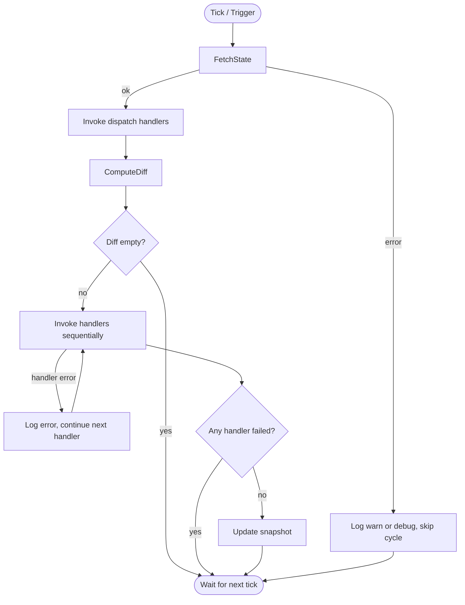

# Configuration Reconciliation

The `internal/reconcile` package implements the core convergence loop that keeps every node aligned with desired state. It periodically fetches the `NodeStateSnapshot` envelope from the control plane, computes a diff against a local snapshot, and invokes pluggable handlers to converge local state toward the envelope.

The pull is one-way: plexd does not report drift corrections back to the control plane. `POST /v1/nodes/{node_id}/drift` no longer exists. Applied-correction visibility will return as node-authored state reports (issue #23).

The envelope carries ten always-present blocks — `peers`, `reachability`, `policy`, `bridge`, `state`, `reports`, `executions`, `sessions`, `secrets`, and `signing_key`. A `null` block means "not populated" rather than "field absent", so the differ compares by presence: a `null` block and a populated block are distinct states, and switching between them drives convergence.

`executions` and `sessions` are the exceptions: both are consumed by the dispatch stage on every successful pull and neither is stored in the local snapshot nor diffed. `executions` is a delivery queue rather than desired state; `sessions` is desired state, but state the tunnel dispatcher converges on itself rather than through the differ.

`signing_key` is consumed by the dispatch stage too, and is not desired state at all: it is the key the node's Domain signs envelopes and session tokens with, and the signing-key dispatch handler installs it on every successful pull. It is neither stored nor diffed. A `null` block means "keep the key you hold", never "drop it".

`secrets` is consumed by the dispatch stage too. It is the node's secret inventory, names and versions only, and the node API's [`SecretIndexDispatchHandler`](nodeapi.md#secretindexdispatchhandler) replaces the secret index from it on every successful pull. It is neither stored nor diffed. A `null` block keeps the index; an empty block empties it.

## Config

`Config` holds reconciliation parameters passed to the `Reconciler` constructor. No file I/O occurs in this package.

| Field      | Type            | Default | Description                        |
|------------|-----------------|---------|------------------------------------|
| `Interval` | `time.Duration` | `60s`   | Time between reconciliation cycles |

```go
cfg := reconcile.Config{
    Interval: 30 * time.Second,
}
cfg.ApplyDefaults() // sets Interval to 60s if zero
if err := cfg.Validate(); err != nil {
    log.Fatal(err) // rejects negative or sub-second intervals
}
```

## StateFetcher

Interface for control plane communication. `*api.ControlPlane` satisfies this interface. It is narrowed to the single pull method; there is no drift-report counterpart.

```go
type StateFetcher interface {
    FetchState(ctx context.Context, nodeID string) (*api.NodeStateSnapshot, error)
}
```

## ReconcileHandler

Function type invoked when drift is detected. Each handler receives the full desired snapshot and the computed diff.

```go
type ReconcileHandler func(ctx context.Context, desired *api.NodeStateSnapshot, diff StateDiff) error
```

Handlers are invoked sequentially in registration order. Errors and panics in one handler do not prevent subsequent handlers from running.

## DispatchHandler

Function type invoked on every successful pull, before the diff. Dispatch handlers consume the snapshot blocks the differ never sees, so an unchanged snapshot still delivers them.

```go
type DispatchHandler func(ctx context.Context, desired *api.NodeStateSnapshot)
```

They return nothing: a dispatch problem is the handler's own to report and never blocks the snapshot update. Panics are recovered and logged, and never count as a handler failure.

Two blocks are consumed on this seam. `executions` is a delivery queue: `actions.Dispatcher.Handle` redelivers each entry until its execution settles through the callback. `sessions` is desired state rather than a queue — an entry stands for as long as its session is valid, and its disappearance is the teardown signal — but `tunnel.Dispatcher.Handle` converges it here rather than behind the diff, because an entry a transient failure left unprovisioned has to be retried on the next pull whether or not the snapshot moved.

The [edge PSK store](../networking/wireguard.md#edge-psks) also runs on this seam, through `wireguard.EdgePSKDispatchHandler`, when the WireGuard interface came up, `wireguard.edge_psk` is not `false` and the node secret key decodes. It reads the `peers` block, which the differ sees as well, and fetches the edge PSK of a peer that first appears, of a peer whose `public_key` changed, and of every peer after this node's own key rotation. It runs here rather than behind the diff so that a failed fetch retries on every pull, drift or not, without failing the WireGuard reconcile handler and holding the snapshot back: the store logs the failure and retries on the next pull. Because dispatch handlers run before the reconcile handlers, a new peer's PSK is fetched before the WireGuard handler adds the peer in the same cycle.

The `signing_key` block is also consumed on this seam, by `signingKeyDispatchHandler` in `cmd/plexd/cmd/up.go`. It is registered first among the dispatch handlers, so the rest of the cycle already runs under the key the pull carried. A `null` block keeps the installed key and logs `state pull carried no signing key; keeping the installed one` at debug. Any other block goes to `api.Ed25519Verifier.Install` on the verifier that checks envelopes and ssh session tokens. A key `Install` refuses changes nothing and logs `signing key from state pull rejected` at warn (with `key_id` and `error`), once until a pull carries a different key. A new key logs `installed signing key from state pull` at info with `key_id` and `public_key`; that `public_key` is the value an operator sets as `tunnel.session_signing_public_key` for a session helper that pinned the previous key. A pulled key that differs from the pair the identity files hold is written there with `registration.CommitSigningKey`, so a restart seeds the verifier from it. A failed write logs `signing key not persisted; retrying on the next pull` at warn (with `key_id` and `error`) and is retried on every pull.

The `secrets` block is consumed on this seam too, by the node API's [`SecretIndexDispatchHandler`](nodeapi.md#secretindexdispatchhandler), which `cmd/plexd/cmd/up.go` registers right after `signingKeyDispatchHandler`. It replaces the secret index that `GET /v1/state/secrets` lists from the block on every successful pull, drift or not. A `null` block keeps the index and logs `state pull carried no secret inventory; keeping the secret index` at debug; an empty block empties it. `node_secrets_updated` only triggers a reconcile, so the pull is the one writer of the index.

## Reconciler

### Constructor

```go
func NewReconciler(client StateFetcher, cfg Config, logger *slog.Logger) *Reconciler
```

- Applies config defaults via `cfg.ApplyDefaults()`
- Initializes an empty state snapshot
- Creates a buffered trigger channel (size 1) for coalescing

### Methods

| Method             | Signature                                                   | Description                                        |
|--------------------|-------------------------------------------------------------|----------------------------------------------------|
| `RegisterHandler`  | `(handler ReconcileHandler)`                                | Adds a handler invoked on drift (call before `Run`) |
| `RegisterDispatchHandler` | `(handler DispatchHandler)`                          | Adds a handler invoked on every successful pull (call before `Run`) |
| `TriggerReconcile` | `()`                                                        | Requests immediate cycle; rapid calls are coalesced |
| `Run`              | `(ctx context.Context, nodeID string) error`                | Blocking loop; returns `ctx.Err()` on cancellation |

### Lifecycle

```go
logger := slog.Default()

client, _ := api.NewControlPlane(apiCfg, "1.0.0", logger)
client.SetAuthToken(identity.NodeSecretKey)

r := reconcile.NewReconciler(client, reconcile.Config{}, logger)

// Register handlers before Run
r.RegisterHandler(func(ctx context.Context, desired *api.NodeStateSnapshot, diff reconcile.StateDiff) error {
    // apply WireGuard peer changes
    return nil
})
r.RegisterHandler(func(ctx context.Context, desired *api.NodeStateSnapshot, diff reconcile.StateDiff) error {
    // apply network policy changes
    return nil
})

// Run blocks until context cancelled
ctx, cancel := context.WithCancel(context.Background())
go func() {
    if err := r.Run(ctx, nodeID); err != nil && err != context.Canceled {
        logger.Error("reconciler failed", "error", err)
    }
}()

// Trigger immediate reconciliation (e.g., after SSE reconnection)
r.TriggerReconcile()

// Graceful shutdown
cancel()
```

### Reconciliation Cycle

Each cycle follows this sequence:



1. **FetchState** — `GET /v1/nodes/{node_id}/state` via `StateFetcher`, returning the `NodeStateSnapshot` envelope
2. **Invoke dispatch handlers** — each called with panic recovery, in registration order. This runs on **every** successful pull, before the diff, so an unchanged snapshot still redelivers the queued entries; the empty-diff short-circuit below can never skip it
3. **ComputeDiff** — compare the desired snapshot against the local snapshot
4. **Skip if empty** — no reconcile handlers invoked
5. **Invoke handlers** — each handler called with panic recovery, in registration order
6. **Update snapshot** — only if every handler succeeded; a single handler failure holds the snapshot back so the same diff re-fires next cycle until it converges

### Error Handling

| Error Source       | Behavior                                              |
|--------------------|-------------------------------------------------------|
| `FetchState` error | Logged at warn, or at debug for `api.ErrCredentialRefused` while the heartbeat is parked (see [Quiet Failure Logs](heartbeat-service.md#quiet-failure-logs)); tick skipped, loop continues |
| Handler error      | Logged at error, other handlers still run, snapshot held back |
| Handler panic      | Recovered with stack trace, treated as error          |
| Dispatch handler panic | Recovered with stack trace, logged at error; never counts as a handler failure and never holds the snapshot back |
| Context cancelled  | `Run` returns `ctx.Err()` immediately                |

### Logging

All log entries use structured keys with `component=reconcile`:

| Key              | Description                          |
|------------------|--------------------------------------|
| `component`      | Always `"reconcile"`                 |
| `node_id`        | Node identifier                      |
| `interval`       | Configured reconciliation interval   |
| `drift`          | Compact `diff.Summary()`, e.g. `"peers+1-0~2 policy bridge state reports"` (or `"none"`) |
| `duration`       | Cycle execution time                 |
| `handler_failed` | Whether any handler returned error   |
| `error`          | Error details (on warn/error levels, and on the debug-level `FetchState failed` for a refused credential) |

## StateDiff

Describes the drift between the desired and current `NodeStateSnapshot`. Peer changes are enumerated; the four block flags are presence-aware, so a `null` block and a populated block are distinct.

```go
type StateDiff struct {
    PeersToAdd    []api.SnapshotPeer
    PeersToRemove []string           // node IDs
    PeersToUpdate []api.SnapshotPeer // peers with changed fields

    PolicyChanged  bool
    BridgeChanged  bool
    StateChanged   bool
    ReportsChanged bool
}
```

### ComputeDiff

```go
func ComputeDiff(desired, current *api.NodeStateSnapshot) StateDiff
```

Comparison logic by block:

| Block   | Match Key         | Detection                                                                 |
|---------|-------------------|---------------------------------------------------------------------------|
| Peers   | `SnapshotPeer.NodeID` | Add/remove by node ID; update when `MeshIP`, `PublicKey`, `Endpoint`, `FallbackEndpoint`, or `EndpointCandidates` differs. Candidates compare in order, because the order is the dial order; nil and empty compare equal |
| Policy  | —                 | Presence-aware; when both blocks are populated it compares **only** the `Fingerprint` byte-for-byte |
| Bridge  | —                 | Presence-aware; both populated → `reflect.DeepEqual`                       |
| State   | —                 | Presence-aware; both populated → `reflect.DeepEqual`                       |
| Reports | —                 | Presence-aware; both populated → `reflect.DeepEqual`                       |

The policy `Fingerprint` is a 44-char base64 SHA-256 that the server computes over its canonical rule stream. plexd treats it as an opaque comparison key and **never re-derives it from the rules**: a revision-only bump (same fingerprint, new `revision_id`) or any rule-array difference that keeps the fingerprint equal is **not** a change, so the ruleset rebuild short-circuits. `reachability` is the control plane's verdict about this node, not desired state, so it is never diffed or stored — the reachability observer decodes it on every successful pull and logs the verdict when it changes, and that is the whole of what plexd does with it. `executions` is a delivery queue whose entries are consumed once by the dispatch stage and settled through the execution callback, not converged on, so it too is never diffed or stored — there is no `ExecutionsChanged` flag, and a pull carrying only new executions still reports an empty diff. `signing_key` is not desired state either, so it is never diffed or stored: there is no `SigningKeyChanged` flag, the signing-key dispatch handler installs the key on every successful pull, and a pull whose only change is a new key reports an empty diff. `secrets` is never diffed either, because the node API's secret-index dispatch handler consumes it on every successful pull: there is no `SecretsChanged` flag, and a pull whose only change is the `secrets` block reports an empty diff.

### Summary

```go
func (d StateDiff) Summary() string
```

Returns a compact description of the diff for the cycle log, e.g. `"peers+1-0~2 policy bridge state reports"`. Only changed parts are mentioned; an empty diff returns `"none"`. It is logged under the `drift` key.

### IsEmpty

```go
func (d StateDiff) IsEmpty() bool
```

Returns `true` when all peer slices are empty and all four block flags are `false`.

## StateSnapshot

In-memory cache of the last known desired state, protected by `sync.RWMutex`.

| Method                                         | Description                                     |
|------------------------------------------------|-------------------------------------------------|
| `NewStateSnapshot() *stateSnapshot`            | Creates empty snapshot                          |
| `Get() api.NodeStateSnapshot`                  | Returns a deep copy of the current snapshot     |
| `Update(desired *api.NodeStateSnapshot)`       | Atomically replaces all blocks (deep copy)      |

All methods deep-copy data to prevent aliasing between snapshot and caller. `reachability` is not desired state, so `Get` always returns it as `nil` and `Update` never stores it; the reachability observer has already read and logged the block on the dispatch seam by the time `Update` runs. The same holds for `executions`: the dispatch stage has already consumed the block by the time `Update` runs, and storing it would make a redelivered entry look like drift. `signing_key` is not desired state either: `Get` always returns it as `nil` and `Update` never stores it, because the signing-key dispatch handler has already consumed the block by the time `Update` runs and the differ has nothing to converge on. `secrets` is never stored either: `Get` always returns it as `nil` and `Update` never stores it, because the node API's secret-index dispatch handler has already handed the block to the secret index by the time `Update` runs.

> Drift reporting has been removed. There is no `BuildDriftReport`, `DriftReport`, or `DriftCorrection`, and `POST /v1/nodes/{node_id}/drift` does not exist upstream. Node-authored state reports (issue #23) will carry applied-correction visibility instead.

## Integration Points

### SSE Reconnection

When `SSEManager` reconnects after a disconnection, call `TriggerReconcile()` to catch up on missed events:

```go
// In the SSE reconnection callback
reconciler.TriggerReconcile()
```

### Heartbeat Reconcile Flag

When a heartbeat response contains `reconcile: true`, trigger an immediate cycle:

```go
resp, err := client.Heartbeat(ctx, nodeID, req)
if err == nil && resp.Reconcile {
    reconciler.TriggerReconcile()
}
```

### Registered Handlers

The agent registers these handlers (in `cmd/plexd/cmd/up.go`):

| Handler                          | Responsibility                                                        |
|----------------------------------|----------------------------------------------------------------------|
| `nodeapi` cache handler          | Feed the local state cache from the snapshot `state` block           |
| `wireguard.ReconcileHandler`     | Apply peer add/remove/update from the `peers` block, with each peer's [dial order](../networking/wireguard.md#dial-order) (on-link `endpoint_candidates`, the usable direct `endpoint`, off-link candidates, `fallback_endpoint`) and the edge PSK held for its current public key (registered only when the WireGuard interface came up) |
| `policy.ReconcileHandler`        | Rebuild the nftables ruleset from the merged `policy` block on a fingerprint change |
| bridge sub-handlers              | Reconcile relay, user-access, ingress, and site-to-site subtrees      |

Signing-key rotation is no longer a reconcile handler. Key material comes from registration, from the pull's `signing_key` block through the signing-key dispatch handler below, and from the `signing_key_rotated` SSE event.

### Registered Dispatch Handlers

| Handler                    | Responsibility                                                     |
|----------------------------|--------------------------------------------------------------------|
| `signingKeyDispatchHandler` | Install the pull's `signing_key` into the verifier that checks envelopes and ssh session tokens, and persist it into the identity files (registered first among the dispatch handlers; see [DispatchHandler](#dispatchhandler)) |
| `nodeAPISrv.SecretIndexDispatchHandler()` | Replace the node API's secret index from the pull's `secrets` block (registered right after `signingKeyDispatchHandler`; `node_secrets_updated` only pulls the block forward; see [SecretIndexDispatchHandler](nodeapi.md#secretindexdispatchhandler)) |
| `actions.Dispatcher.Handle`| Turn each entry of the `executions` block into an action execution |
| `wireguard.EdgePSKDispatchHandler` | Fetch, open and install the edge PSKs the `peers` block makes due (registered only when the WireGuard interface came up, `wireguard.edge_psk` is not `false` and the node secret key decodes) |

See [Remote Actions and Hooks](/reference/actions/remote-actions-hooks) for the dispatcher's decision table.
