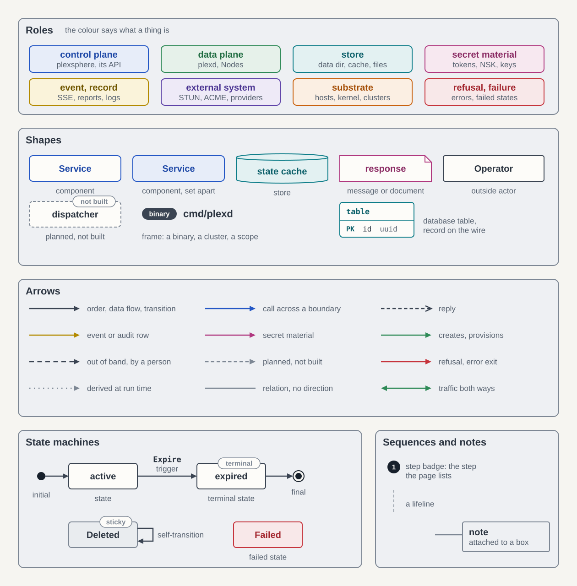

# Diagrams

The figures of these docs live in `docs/diagrams/`. Each one is a pair: a
`.drawio` file, the draw.io source, and an `.svg` file, its export, which
the pages embed. Both files of every pair are drawn by
`tools/docs-figures`, a small Go program in which each figure is one
function. The program renders the draw.io source and the SVG from the
same elements, so the two files of a pair cannot disagree. The program,
its notation and its colours come from the plexsphere docs, so a figure
looks the same in both.

The docs carry no ASCII art and no Mermaid blocks: a text drawing breaks
the moment a label grows, and a Mermaid block lays itself out in the
reader's browser, differently from the figures around it. A figure that
explains a flow, a state machine, a packet layout or a topology is a pair
in `docs/diagrams/`. Directory trees, command synopses, rule listings and
other text a reader copies stay in fenced code blocks.

## Change a figure

1. Find the figure's function: the [inventory](#inventory) names the
   file, and the file name's prefix names the source file,
   `tools/docs-figures/fig_<prefix>.go`. The `bridge-` figures of user
   access, site-to-site VPN and the VPN and tunnel providers are in
   `fig_bridge_access.go`.
2. Edit the function. The helpers in `draw.go`, `seq.go` and `table.go`
   say what a thing is (a `box`, a `store`, a `state`, a `call`) and
   place it; see [Notation](#notation) for the full set.
3. Run `make docs-figures`. It validates every figure and rewrites both
   files of every pair. The validation rejects a label wider or taller
   than its box, two boxes that overlap, a label that straddles the
   outline of a box, and an arrow that runs through a box.
4. Run `npm run docs:dev`, open every page the inventory lists for the
   figure, and check it in the light and the dark theme.
5. Commit the function and both files of the pair together.
   `TestCommittedFiguresMatchTheGenerator` in `tools/docs-figures` fails
   when a committed pair differs from what its function draws, so a pair
   edited by hand, or a function changed without the regeneration, is a
   red build.

The `.drawio` files open in the draw.io desktop app, in
[diagrams.net](https://app.diagrams.net), and in VS Code with the Draw.io
Integration extension. They are stored uncompressed, so a change shows up
as a readable diff. A change made there is overwritten by the next
`make docs-figures`; to maintain a figure in draw.io instead, remove its
function from its group in `tools/docs-figures` in the same commit, and
from then on export it with **File › Export as › SVG**, **Transparent
Background** unchecked and a **Border Width** of 40.

## Add a figure

1. Write a function that returns the `*Figure`, name it after the file,
   and append it to the group of its `fig_<prefix>.go` file. The file
   name is a prefix from [File names](#file-names) and the subject, in
   lower case, words joined by hyphens.
2. Run `make docs-figures`.
3. Embed the SVG with a Markdown image. On a page directly under `docs/`
   the path is `./diagrams/<name>.svg`; a page further down puts one
   `../` per directory level in front of `diagrams/<name>.svg`, so a page
   two levels down spells it `../../diagrams/<name>.svg`.
4. Give the image an alt text that says what the figure shows, in full
   sentences: a reader who cannot see the figure gets the alt text
   instead. Every embed of a figure carries the same alt text.
5. Add a row to the [inventory](#inventory) that lists every page that
   embeds the figure.

The tests in `tools/docs-figures` hold this together: they fail when a
pair is incomplete, when the inventory and the pairs disagree, when the
pages listed in a row are not the pages that embed the figure, when two
embeds of a figure carry different alt texts, and when a fenced code
block in the docs holds ASCII art or Mermaid. `npm run docs:build` fails
on an embed whose file is missing.

## Inventory

| Diagram | Shows | Embedded in |
| --- | --- | --- |
| `architecture-overview` | The control plane, the five kinds of nodes on an outbound-only HTTPS and SSE link, the encrypted mesh between them, and the user access and external traffic behind the bridge | [Plexsphere Node Agent Documentation: High-Level Overview](../../index.md#high-level-overview) |
| `architecture-detailed` | The four control plane components, the plexd nodes with their mesh IPs, the full WireGuard mesh, and the mesh and access sides of the bridge with their consumers | [Architecture: Detailed Architecture](../../guide/architecture.md#detailed-architecture) |
| `architecture-agent-lifecycle` | The agent's phases from start through registration, tunnel setup and NAT discovery to the connected steady state and its subsystems, and the shutdown with its steps | [Agent Lifecycle: Agent Lifecycle](../../guide/agent-lifecycle.md#agent-lifecycle) |
| `architecture-startup-sequence` | The initialization steps of `plexd up` in six groups, from parsing the config to launching the goroutines | [Agent Internals: Startup Sequence (`plexd up`)](../../concepts.md#startup-sequence-plexd-up) |
| `architecture-shutdown-sequence` | The shutdown of `plexd up` from SIGTERM or SIGINT through the mesh DNS revert, the bridge, firewall and WireGuard teardowns to the wait for the goroutines of at most 30 s and the one exit | [Agent Internals: Shutdown Sequence](../../concepts.md#shutdown-sequence) |
| `communication-channels` | The five channels plexd opens to the control plane: registration, the SSE event stream, the heartbeat, reconciliation and observability | [Platform Communication & Mesh Networking: How plexd Communicates with Plexsphere](../../guide/platform-communication.md#how-plexd-communicates-with-plexsphere) |
| `communication-node-lifecycle` | The four phases of a node from first boot to shutdown: bootstrap, tunnel setup, steady state and shutdown | [Platform Communication & Mesh Networking: Node Lifecycle](../../guide/platform-communication.md#node-lifecycle) |
| `communication-mesh-topology` | The control plane, the full mesh of P2P tunnels between three nodes and a bridge, and the bridge's external access | [Platform Communication & Mesh Networking: The Encrypted Mesh Network](../../guide/platform-communication.md#the-encrypted-mesh-network) |
| `communication-mesh-capabilities` | What the WireGuard mesh enables on every node and what a bridge node adds | [Platform Communication & Mesh Networking: What the Mesh Enables](../../guide/platform-communication.md#what-the-mesh-enables) |
| `security-trust-chain` | The chain of trust from the bootstrap token through the control plane and its signing key to the node identity and the peer tunnels | [Security & Trust Model: Trust Chain](../../guide/security.md#trust-chain) |
| `security-registration` | The registration exchange in which only the public key leaves the node and the control plane returns the NSK | [Security & Trust Model: Phase 1: Registration](../../guide/security.md#phase-1-registration) |
| `security-key-rotation` | A WireGuard key rotation from the signed rotate_keys event to the refetched edge PSKs | [Security & Trust Model: Phase 4: Key Rotation](../../guide/security.md#phase-4-key-rotation) |
| `security-signing-key-rotation` | How a node installs a rotated Domain signing key from its next state pull | [Security & Trust Model: Signing Key Rotation](../../guide/security.md#signing-key-rotation) |
| `core-registration-flow` | The Registrar's registration sequence with the TokenResolver, the control plane and the disk: the cached identity, or the fresh registration from the bootstrap token to the NSK | [Registration: Register](../core/registration.md#register) |
| `core-sse-connection-states` | The state machine of the SSE connection: Disconnected, Connecting, Connected, Backoff, Polling, PullOnly and Stopped with their transitions | [Control Plane Client: State Machine](../core/control-plane-client.md#state-machine) |
| `core-heartbeat-loop` | The heartbeat loop of the HeartbeatService against the control plane, with the 200, 401 and other-error branches and the directive flags | [Heartbeat Service: Heartbeat Loop](../core/heartbeat-service.md#heartbeat-loop) |
| `core-reconciliation-cycle` | One reconciliation cycle from the tick or trigger through FetchState, the dispatch handlers, ComputeDiff and the handlers to the snapshot update | [Configuration Reconciliation: Reconciliation Cycle](../core/reconciliation.md#reconciliation-cycle) |
| `core-event-verification-pipeline` | The path of an SSE event from the control plane through the SSE stream, the Ed25519Verifier and the EventDispatcher to the handlers, and the SSEManager that builds the stream | [Event Verification: Architecture](../core/event-verification.md#architecture) |
| `core-execution-callback-states` | The callback states of an action execution, from pending through ack and started to the terminal succeeded, failed or cancelled, with the self-edge of started | [Control Plane API Endpoints: POST /v1/nodes/{node_id}/executions/{execution_id}](../core/api-endpoints.md#post-v1-nodes-node-id-executions-execution-id) |
| `actions-integrity-verification` | One pass of the integrity verifier, started by `Verifier.Run` and by every tick: the binary, hooks and host key checks against the stored baseline, a logged match, a mismatch reported to the control plane, and the observed value adopted as the baseline once the report is accepted | [Integrity Verification: Data Flow](../actions/integrity-verification.md#data-flow) |
| `actions-dispatch-flow` | An execution from the executions block of the state pull through the reconciler dispatch stage, the decisions of `Dispatcher.Handle` and the checks of `Executor.Execute` to the run goroutine | [Remote Actions and Hooks: Data Flow](../actions/remote-actions-hooks.md#data-flow) |
| `actions-run-flow` | The run goroutine branching into `runBuiltin` or the seven steps of `runHook`, and the terminal execution callback to the control plane | [Remote Actions and Hooks: Data Flow](../actions/remote-actions-hooks.md#data-flow) |
| `actions-session-authorization` | The sequence of an action run from a mediated SSH session: the session token that authorizes the login only, the user's shell, the node API socket's permission check, the built-in run and the result, with nothing reported to the control plane | [Action Authorization: Running an Action from an SSH Session](../actions/session-authorization.md#running-an-action-from-an-ssh-session) |
| `actions-local-transport` | `plexd actions run` reaching the plexd daemon over the node API socket, the refusals of `Executor.RunLocal` and the built-in run, with nothing reported to the control plane | [Action Authorization: Local Transport](../actions/session-authorization.md#local-transport) |
| `actions-hook-execution-lifecycle` | The sequence of a hook execution between the control plane and plexd, from the state pull and the claim callbacks through the checks and the run to the terminal callback | [Creating Custom Hook Scripts: Execution Lifecycle](../../how-to/custom-hook-scripts.md#execution-lifecycle) |
| `bridge-mode-data-flow` | Traffic between the mesh peers and the access subnets through plexd0, the kernel's IP forwarding and NAT and eth1, and the Bridge Manager that programs them through the RouteController | [Bridge Mode: Data Flow](../bridge/bridge-mode.md#data-flow) |
| `bridge-nat-relay` | The relay's dispatch loop between two peers behind NAT, from the UDP socket through parseWGMessage to the destination lookup, and the state pull that configures or stops it | [NAT Relay: Data Flow](../bridge/nat-relay.md#data-flow) |
| `bridge-netlink-route-controller` | The bridge, user access and site-to-site managers, in bridge mode only, and the WireGuard manager, for the peer routes on every node, calling NetlinkRouteController, which programs routes through netlink, forwarding through sysctl, and NAT and the mesh source rewrite through nftables | [Netlink Route Controller: Architecture](../bridge/netlink-route-controller.md#architecture) |
| `bridge-route-controllers-macos-windows` | The bridge manager, in bridge mode only, and the WireGuard manager, for the peer routes on every node, calling DarwinRouteController or WindowsRouteController; the user access and site-to-site managers, in bridge mode, calling both route controllers, PFController for the mesh source rewrite on macOS, wireguard.MeshRewriter for the rewrite on Windows and WFPController for a tunnel's NAT exemption on Windows; and the tools and firewall controllers each route controller delegates to | [macOS & Windows Route Controllers: Architecture](../bridge/route-controllers-macos-windows.md#architecture) |
| `bridge-public-ingress` | A public TCP connection through a plain or SNI listener of the bridge, or the datagrams of a UDP client through a UDP listener with one flow per client address, to a target node over the mesh; on the SNI listener a terminate or acme host copies bytes, or, when its rules have conditions, reads each request and routes it to one rule by path and headers; and the handlers that feed the listeners and certificates | [Public Ingress: Data Flow](../bridge/public-ingress.md#data-flow) |
| `bridge-acme-sni-routing` | A TLS connection on an SNI port from the ClientHello peek through the server-name match to the ACME challenge, passthrough or termination, the three stages that close a connection, and ACMEManager's account and cache | [ACME and SNI Routing: Data Flow](../bridge/acme-sni.md#data-flow) |
| `bridge-user-access-data-flow` | Devices of a wireguard provider reaching the mesh peers through the provider's interface wg-ua-a0a0a0e1, forwarding with the source rewrite, and plexd0 on a bridge node; the AccessController, UserAccessManager and InterfaceKeyStore; the control plane reaching the UserAccessReconcileHandler through the bridge_config_updated event and the reconcile, the handler calling Apply, and the UserAccessStatusReporter sending the status report | [User Access Integration: Data Flow](../bridge/user-access-integration.md#data-flow) |
| `bridge-site-to-site-data-flow` | A remote site reaching the mesh peers through the tunnel links wg-s2s-, xf-s2s- and ov-s2s-, routes, forwarding with the source rewrite, and plexd0 on a bridge node, and the mesh peers routing the site's networks through the bridge; the VPNController, SiteToSiteManager, InterfaceKeyStore, RouteController and MeshSourceRewriter, and TunnelProvider; the control plane reaching the SiteToSiteReconcileHandler, which calls Apply, and the SiteToSitePullHandler through the bridge_config_updated event and the reconcile, and the SiteToSiteStatusReporter sending the status report | [Site-to-Site VPN: Data Flow](../bridge/site-to-site-vpn.md#data-flow) |
| `bridge-vpn-providers-data-flow` | Tailscale or NetBird users reaching the mesh peers through the client's interface, forwarding with the source rewrite, and plexd0 on a bridge node; the UserAccessClient and CommandExecutor, the UserAccessManager starting and stopping the client, and the nodeSecretFetcher fetching the join key from the control plane | [VPN Providers: Data Flow](../bridge/vpn-providers.md#data-flow) |
| `bridge-tunnel-providers-data-flow` | A remote site reaching the mesh peers through the xfrm interface or tun device of an ipsec or openvpn tunnel and plexd0 on a bridge node; the VPNController creating the link, the SiteToSiteManager calling CreateTunnel with the key on the IPsecProvider or OpenVPNProvider, which writes the tunnel files under the run directory and runs swanctl and openvpn through the CommandExecutor, and the host's strongSwan and the openvpn processes | [Tunnel Providers: Data Flow](../bridge/tunnel-providers.md#data-flow) |
| `networking-mesh-dns-data-flow` | How the dns block of the state pull reaches the mesh DNS server and the per-OS registrar, and the queries the server answers and forwards | [Mesh DNS: Data Flow](../networking/mesh-dns.md#data-flow) |
| `networking-stun-binding-request` | The fields of the 20-byte STUN Binding Request in 32-bit rows | [NAT Traversal via STUN: Binding Request Format (20 bytes)](../networking/nat-traversal.md#binding-request-format-20-bytes) |
| `networking-stun-padded-binding-request` | The fields of the padded STUN Binding Request of the path MTU probe: the plain header followed by the PADDING attribute | [NAT Traversal via STUN: Padded Binding Request](../networking/nat-traversal.md#padded-binding-request) |
| `networking-policy-data-flow` | How the merged policy of the state pull reaches the firewall controller, and how the policy status report goes back | [Network Policy Enforcement: Data Flow](../networking/network-policy.md#data-flow) |
| `networking-nftables-architecture` | How the firewall rules reach the three chains of the inet table plexd through the nftables controller | [nftables Firewall Controller: Architecture](../networking/nftables-firewall.md#architecture) |
| `networking-peer-endpoint-data-flow` | The outbound STUN report loop and the inbound state pull that carries peer endpoints to the WireGuard manager | [Peer Endpoint Exchange: Data Flow](../networking/peer-endpoint-exchange.md#data-flow) |
| `networking-tunnel-data-flow` | How the sessions block of the state pull becomes a TCP listener whose forwarder copies to the target host | [Secure Access Tunneling: Data Flow](../networking/secure-access-tunneling.md#data-flow) |
| `development-docker-topology` | The mock-api, plexd and meshpeer services of the Docker end-to-end test on the e2e-net bridge network, with plexd's calls and its WireGuard tunnel | [Docker E2E Test: Service Topology](./docker-e2e-test.md#service-topology) |
| `development-kubernetes-topology` | The kind cluster of the Kubernetes end-to-end test with the plexd DaemonSet, the mock-api Deployment and Service, and the port-forward the test script polls through | [Kubernetes E2E Test: Cluster Topology](./kubernetes-e2e-test.md#cluster-topology) |
| `development-systemd-topology` | The mock-api, systemd, ingress target, Pebble, device, mesh node and site containers of the systemd end-to-end test on their Docker network, with the calls, probes, ACME, TLS-ALPN-01 and WireGuard tunnels between them | [Systemd E2E Test: Container Topology](./systemd-e2e-test.md#container-topology) |
| `conventions-legend` | The notation of the figures: roles, shapes, arrows, state machines, sequences and notes | [Diagrams: Notation legend](#notation-legend) |

## File names

A file is named `<prefix><subject>`, lower case, words joined by hyphens.
The prefix is the part of the docs the figure explains.

| Prefix | Figures |
| --- | --- |
| `architecture-` | The agent as a whole: the overview, the architecture and lifecycle guides, the internals page |
| `communication-` | The platform communication guide: registration, the event stream, the state pull, the mesh |
| `security-` | The security and trust model guide |
| `core-` | The core reference: registration, the control plane client, heartbeat, reconciliation, event verification, the API endpoints |
| `actions-` | Remote actions and hooks, integrity verification, session authorization |
| `bridge-` | Bridge mode: the relay, the route controllers, public ingress, ACME, user access, site-to-site VPN, the providers |
| `networking-` | The mesh: WireGuard, NAT traversal, peer endpoint exchange, network policy, the firewall, mesh DNS, secure access tunneling |
| `development-` | The development reference: the end-to-end test topologies |
| `conventions-` | Figures about the figures: the legend |

## Visual conventions

The figures are drawn for a canvas of about 1,100 pixels, which the docs
site scales into its content column; a wider figure stays legible because
the smallest text is 15 pixels. The font is IBM Plex Sans, and IBM Plex
Mono for identifiers. An SVG embedded as an image loads no web fonts, so
a reader without IBM Plex installed sees Arial, Helvetica or DejaVu Sans;
every box is sized for DejaVu Sans, the widest of them. The background is
`#F6F5F1` in both themes, so the dark labels stay readable on the dark
theme of the docs.

The colour of a box says what it is:

| Role | Stroke | Text | Fill |
| --- | --- | --- | --- |
| plexsphere control plane: its services and the API plexd calls | `#2457C5` | `#1D47A6` | `#E7EDF9` |
| plexd, its packages and subsystems, and the Nodes: the data plane | `#2F8A57` | `#1E6B40` | `#E6F1EA` |
| Store or persistent state: the data directory, the state cache, a file on the Node | `#0E7D89` | `#0B5F69` | `#E3F1F2` |
| Secret material and key custody: tokens, the NSK, WireGuard and signing keys, session JWTs | `#B0387F` | `#8A2B63` | `#F7E8F0` |
| Event or record on its way: SSE events, callbacks, reports, log and audit records | `#B38A00` | `#6F5600` | `#FAF3DA` |
| External system: STUN servers, an ACME CA, a VPN or tunnel provider, an identity provider | `#5E43A8` | `#4B3592` | `#EEEAF7` |
| Substrate: the host and its kernel, a VM, a cluster, a bridge host, netlink, nftables | `#C9620F` | `#A44E07` | `#FBEFE3` |
| Refusal, error exit, failed state | `#C6343C` | `#A3262E` | `#F8E8E9` |
| Frame, anything without a role | `#7D8794` | `#2B3440` | `#EEF0F3` |

### Notation legend

### Notation

| Element | Meaning | Looks like | Helper |
| --- | --- | --- | --- |
| Component | A service, a package, a process, a participant | Rounded box, outline in the role colour, bold name | `box` |
| Component, set apart | The component a figure is about | The same box filled with the role colour | `filled` |
| Store | A data directory, a cache, a file, a database | Cylinder in the role colour | `store` |
| Message or document | A response, a request body, a document | Sheet with a folded corner | `sheet` |
| Outside actor | An operator, a user, a browser | Dark outlined box | `actor` |
| Frame | A binary, a host, a cluster, a scope, an arm of a state machine | Large light frame with a bold title and an optional dark chip | `frame` |
| Planned part | Designed, not built | Dashed box with a `not built` chip | `dashedBox`, `chip` |
| Record | The fields of a wire message, a table | Box with a header and one row per field | `record` |
| State | A state of a state machine, a step of a pipeline | Box with slightly rounded corners, dark outline | `state` |
| Terminal, sticky | A state the machine never leaves | The state with a `terminal` or `sticky` chip, or followed by the final marker | `chipOn`, `final` |
| Sink | A state left only by an intervention, or kept forever | The state in grey | `state(stateSink, …)` |
| Failed state, refusal | A failure, an error response | The state in red | `state(stateFailed, …)` |
| Initial and final marker | Where a machine starts and ends | A dark dot; a ring around a dot | `dot`, `final` |
| Self-transition | A transition back into the same state | A loop on the right of the state | `loop` |
| Step badge | Step n of a flow the page describes | Dark circle with a light number at the tail of an arrow or on a box | `badge` |
| Note | A remark on a box | Grey panel joined to the box by a thin line | `notePanel` |
| Order, transition | What comes first points at what follows | Dark arrow | `flow` |
| Call | A request across a process or network boundary | Blue arrow | `call` |
| Reply | The answer to a call | Dashed dark arrow with an open head | `reply` |
| Event, record | An event or a record on its way | Ochre arrow | `publish` |
| Secret material | A secret value travels in the arrow's direction | Magenta arrow | `secretFlow` |
| Creates | plexd or the control plane creates or provisions what the arrow points at | Green arrow | `creates` |
| Out of band | A hand-off a person makes outside plexd and the control plane | Dashed dark arrow | `outOfBand` |
| Planned path | Designed, not built | Dashed grey arrow | `planned` |
| Refusal | The exit to an error | Red arrow | `refuse` |
| Derived | A relation that holds at run time without being stored | Dotted grey arrow | `derived` |
| Relation | A mount, membership, an association | Grey line without a head | `relation` |
| Traffic | Traffic in both directions | Green line with a head at each end | `both` |

A sequence diagram is drawn with `sequence` in `seq.go`: participants
across the top, a lifeline under each, and one message per row with
`msg`, `self` and `note`.
